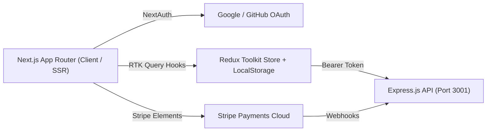
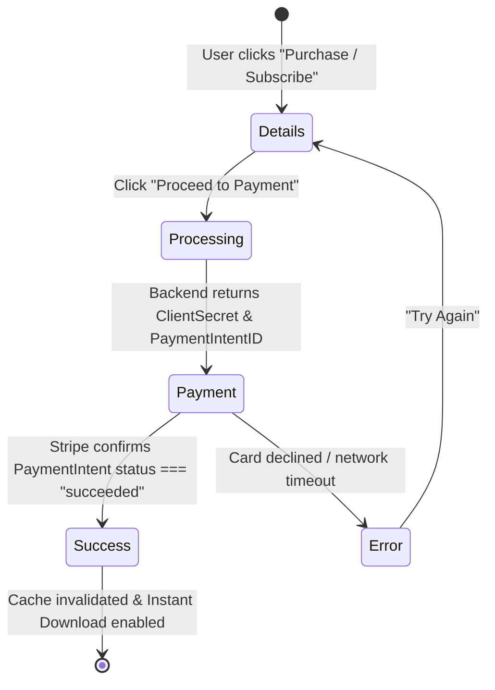

# 🎨 LZ Fly — Frontend Web Application

[](https://nextjs.org/)
[](https://react.dev/)
[](https://www.typescriptlang.org/)
[](https://tailwindcss.com/)
[](https://redux-toolkit.js.org/)
[](https://stripe.com/)
[](LICENSE)

An ultra-modern, high-performance web application for the **LZ Fly** digital asset marketplace and subscription platform. Engineered with **Next.js 15 App Router**, **React 19**, **Turbopack**, **Tailwind CSS 4**, **RTK Query**, **NextAuth.js**, and **Stripe Elements**.

---

## 📋 Table of Contents

- [Overview & Philosophy](#-overview--philosophy)
- [Design System & Aesthetic Guidelines](#-design-system--aesthetic-guidelines)
- [Architecture & Tech Stack](#-architecture--tech-stack)
- [Project Directory Structure](#-project-directory-structure)
- [Environment Configuration](#-environment-configuration)
- [Getting Started](#-getting-started)
- [Authentication & OAuth Flow](#-authentication--oauth-flow)
- [State Management & RTK Query](#-state-management--rtk-query)
- [Stripe Payment Engine & Modal Lifecycle](#-stripe-payment-engine--modal-lifecycle)
- [Page & Route Map](#-page--route-map)
- [Scripts & Development](#-scripts--development)
- [Deployment Guide](#-deployment-guide)

---

## 🌟 Overview & Philosophy

**LZ Fly Frontend** is crafted to provide a frictionless, lightning-fast digital asset shopping experience. Whether browsing thousands of digital templates, subscribing to unlimited download plans, or managing assets in user/admin portals, the UI delivers instant feedback, zero layout shifts, and accessible contrast.

### Key Highlights:
- **Zero-Latency Navigation**: Optimized with Next.js 15 App Router and Turbopack compiler.
- **Hybrid Authentication**: Seamless switching between credentials-based login and Google/GitHub OAuth with automatic token synchronization.
- **In-App Checkout Experience**: Embedded Stripe Elements with dynamic order review breakdown, real-time polling, and instant download activation.
- **Role-Based Portals**: Tailored interfaces for standard users and administrators with full CRUD capabilities.

---

## 📐 Design System & Aesthetic Guidelines

The platform strictly adheres to an **Ultra-Professional Minimalist Design System**:

| Constraint | Rule | Purpose |
| :--- | :--- | :--- |
| **Gradients** | **0% Gradients** (`bg-gradient-*`, `from-*`, `to-*` prohibited) | Clean, flat modern aesthetic |
| **Box Shadows** | **0% Shadows** (`shadow-*`, `drop-shadow-*` prohibited) | Crisp surface borders without artificial depth |
| **Blurs** | **0% Blurs** (`backdrop-blur-*`, `blur-*` prohibited) | High rendering performance and clarity |
| **Surfaces** | Semantic tokens: `bg-card`, `bg-background`, `bg-muted/30` | Full light & dark theme compliance |
| **Borders** | Crisp 1px solid: `border border-border` | Clear visual structure and demarcation |
| **Typography** | `text-foreground`, `text-muted-foreground`, larger scale | High legibility and contrast ratios |

---

## 🛠 Architecture & Tech Stack



- **Framework**: [Next.js 15.5.5](https://nextjs.org/) (App Router, Turbopack, Server Actions)
- **UI & Components**: React 19, [Radix UI](https://www.radix-ui.com/), [Lucide React Icons](https://lucide.dev/)
- **Styling**: [Tailwind CSS 4](https://tailwindcss.com/)
- **State & Data Fetching**: [Redux Toolkit](https://redux-toolkit.js.org/) & [RTK Query](https://redux-toolkit.js.org/rtk-query/overview)
- **Authentication**: [NextAuth.js v4](https://next-auth.js.org/) + Custom JWT Sync Hook
- **Payments**: [@stripe/stripe-js](https://stripe.com/docs/js) & [@stripe/react-stripe-js](https://stripe.com/docs/stripe-js/react)
- **Forms & Validation**: React Hook Form with Zod

---

## 📂 Project Directory Structure

```text
lz-fly-frontend/
├── src/
│   ├── app/                            # Next.js 15 App Router directory
│   │   ├── (auth)/                     # Auth routes: /login, /register
│   │   ├── about/                      # About page
│   │   ├── admin/                      # Comprehensive Admin Dashboard
│   │   │   ├── categories/             # Category management
│   │   │   ├── designs/                # Asset catalog management & likers
│   │   │   ├── downloads/              # Download quota analytics
│   │   │   ├── payments/               # Payment audit trail
│   │   │   ├── pricing-plans/          # Subscription plan tiers
│   │   │   ├── purchases/              # Orders and customer transactions
│   │   │   ├── reviews/                # Review moderation queue
│   │   │   └── users/                  # User accounts & role assignment
│   │   ├── api/auth/[...nextauth]/     # NextAuth OAuth callback handler
│   │   ├── categories/                 # Category browser
│   │   ├── contact/                    # Contact support page
│   │   ├── dashboard/                  # User Personal Dashboard
│   │   │   ├── available-downloads/    # Direct ZIP download portal
│   │   │   ├── downloads-history/      # Historical downloads log
│   │   │   ├── liked-designs/          # Bookmarked assets
│   │   │   ├── payment-history/        # Invoices and receipts
│   │   │   ├── purchases/              # Active subscriptions & items
│   │   │   └── reviews/                # Authored reviews
│   │   ├── designs/                    # Catalog search & [id] detail page
│   │   ├── payment/                    # /success and /failed return views
│   │   ├── pricing/                    # Pricing tiers & subscription purchase
│   │   ├── layout.tsx                  # Root HTML layout & font registration
│   │   ├── loading.tsx                 # Ultra-clean minimalist loader
│   │   ├── page.tsx                    # Landing homepage
│   │   └── globals.css                 # Theme variables & base styling
│   ├── components/                     # Reusable modular UI components
│   │   ├── ui/                         # Base primitives (button, dialog, input)
│   │   ├── AuthWrapper.tsx             # Route protection & role enforcement
│   │   ├── LZLoader.tsx                # Polished minimalist branding loader
│   │   ├── PaymentForm.tsx             # Embedded Stripe Elements form
│   │   ├── PaymentStatusChecker.tsx    # Live transaction polling badge
│   │   ├── PurchaseModal.tsx           # Multi-step checkout modal dialog
│   │   ├── SessionSync.tsx             # NextAuth to Express token sync
│   │   ├── StripeProvider.tsx          # Stripe context wrapper
│   │   └── VideoCarousel.tsx           # Minimalist hero media presentation
│   ├── hooks/                          # Custom React hooks (useSessionSync, etc.)
│   ├── lib/                            # Type declarations & utility helpers
│   ├── services/
│   │   └── api.ts                      # RTK Query API slice definitions
│   └── store/
│       ├── features/authSlice.ts       # Authentication slice with persistence
│       ├── hooks.ts                    # Typed useDispatch & useSelector
│       ├── index.ts                    # Redux store configuration
│       └── ReduxProvider.tsx           # Client root Redux provider
├── public/                             # Static media, SVGs, and hero videos
├── .env.local                          # Local environment variables
├── package.json                        # Scripts & dependencies
└── tsconfig.json                       # TypeScript compiler settings
```

---

## ⚙️ Environment Configuration

Create a `.env.local` file in the `lz-fly-frontend/` directory:

```env
# Backend API Base Endpoint
NEXT_PUBLIC_API_URL=http://localhost:3001/api

# NextAuth Authentication
NEXTAUTH_URL=http://localhost:3000
NEXTAUTH_SECRET=your_nextauth_jwt_secret_key_min_32_characters

# OAuth Credentials (Google Cloud Console)
GOOGLE_CLIENT_ID=your_google_client_id.apps.googleusercontent.com
GOOGLE_CLIENT_SECRET=your_google_client_secret

# OAuth Credentials (GitHub Developer Settings)
GITHUB_ID=your_github_client_id
GITHUB_SECRET=your_github_client_secret

# Stripe Public Key
NEXT_PUBLIC_STRIPE_PUBLISHABLE_KEY=pk_test_51...
```

---

## 🚀 Getting Started

### 1. Prerequisites
- **Node.js**: v18.0.0 or higher
- **Backend API**: Running on `http://localhost:3001`

### 2. Installation
```bash
cd lz-fly-frontend
npm install
```

### 3. Development Server
```bash
npm run dev
```
Open [http://localhost:3000](http://localhost:3000) in your browser.

### 4. Production Build & Check
```bash
# Typecheck
npx tsc --noEmit

# Production build with Next.js Turbopack
npm run build

# Start production server
npm start
```

---

## 🔑 Authentication & OAuth Flow

The application provides a unified authentication bridge between NextAuth and the Express REST API:

1. **OAuth Sign-In**: User triggers Google or GitHub login via [`OAuthButtons.tsx`](file:///z:/projects/lz-fly/lz-fly-frontend/src/components/OAuthButtons.tsx).
2. **Session Capture**: NextAuth callback processes tokens at `/api/auth/callback/[provider]`.
3. **Backend Sync**: [`SessionSync.tsx`](file:///z:/projects/lz-fly/lz-fly-frontend/src/components/SessionSync.tsx) listens for the session, forwards user details to `POST /api/auth/oauth-sync`, and receives a long-lived JWT access token.
4. **Redux Store**: The token and user profile (including `role`: `user`, `admin`, or `super_admin`) are saved to Redux and persisted in `localStorage` for automatic authorization headers on every RTK Query call.

---

## ⚡ State Management & RTK Query

All data fetching, caching, and server state synchronizations are handled by **RTK Query** in [`src/services/api.ts`](file:///z:/projects/lz-fly/lz-fly-frontend/src/services/api.ts).

### Automated Cache Invalidation Tags:
- `Purchases`: Invalidated immediately upon payment confirmation.
- `Downloads`: Refreshed when quota changes or files are downloaded.
- `Designs`: Updated when reviews are posted or likes are toggled.
- `PricingPlans`: Refreshed after admin tier adjustments.

---

## 💳 Stripe Payment Engine & Modal Lifecycle

The checkout experience is powered by [`PurchaseModal.tsx`](file:///z:/projects/lz-fly/lz-fly-frontend/src/components/PurchaseModal.tsx):



1. **Review Order (`details`)**: Summarizes product image/icon, plan duration, original price, discount badges, inclusion checklist, and SSL security badges.
2. **Processing (`processing`)**: Contacts backend `POST /api/payments/create-payment-intent` to register the session.
3. **Checkout (`payment`)**: Renders embedded [`PaymentForm.tsx`](file:///z:/projects/lz-fly/lz-fly-frontend/src/components/PaymentForm.tsx) inside [`StripeProvider.tsx`](file:///z:/projects/lz-fly/lz-fly-frontend/src/components/StripeProvider.tsx) with "Back" button navigation.
4. **Status Confirmation (`success`)**: Mounts [`PaymentStatusChecker.tsx`](file:///z:/projects/lz-fly/lz-fly-frontend/src/components/PaymentStatusChecker.tsx) which polls backend verification and triggers automatic cache invalidation.

---

## 🗺 Page & Route Map

### Public & Marketing
- `/` — Homepage with hero showcase, category filters, and featured assets
- `/categories` — Grid browser of all digital product categories
- `/designs` — Searchable catalog with sorting, price filters, and pagination
- `/designs/[id]` — Detailed asset page with preview lightbox, specs, author, and purchase action
- `/pricing` — SaaS subscription tiers with feature comparisons and active plan status
- `/about` — Platform story, design philosophy, and mission
- `/contact` — Support and inquiry submission form

### User Dashboard (`/dashboard`)
- `/dashboard` — Account overview, download quota counter, and quick links
- `/dashboard/purchases` — Receipts, orders, and active subscriptions
- `/dashboard/available-downloads` — One-click direct downloads for purchased assets
- `/dashboard/downloads-history` — Complete historical download logs
- `/dashboard/liked-designs` — Personal favorites collection
- `/dashboard/reviews` — Submitted feedback and star ratings

### Admin Dashboard (`/admin`)
- `/admin` — System analytics, user growth, and revenue overview
- `/admin/designs` — Product catalog management, upload, update, and likers inspection
- `/admin/categories` — Category creation, icon management, and visibility toggles
- `/admin/pricing-plans` — Plan creation, pricing tiers, and quota limits
- `/admin/users` — User account inspection, role modifications, and suspensions
- `/admin/purchases` — Master transaction ledger
- `/admin/payments` — Stripe transaction tracking and status verification
- `/admin/downloads` — System-wide asset download telemetry
- `/admin/reviews` — Customer review moderation and deletion

---

## 📜 Available Scripts

| Script | Command | Purpose |
| :--- | :--- | :--- |
| **Development** | `npm run dev` | Starts Next.js development server with Turbopack |
| **Type Check** | `npx tsc --noEmit` | Validates TypeScript types across the entire project |
| **Production Build** | `npm run build` | Compiles optimized production bundle |
| **Start Production** | `npm start` | Runs production server on port 3000 |
| **Linting** | `npm run lint` | Inspects code against Next.js ESLint rules |

---

<p align="center">
  <b>LZ Fly</b> • Next-Generation Digital Asset Marketplace Frontend<br>
  Designed for speed, clarity, and an uncompromising ultra-professional user experience.
</p>
